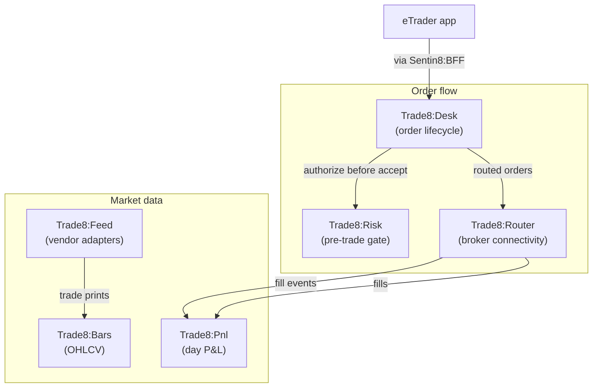

# Trade8 — the professional trading vertical

Trade8 is the broker-side trading vertical on Sentin8: order
management, broker connectivity, synchronous pre-trade risk, market
data, OHLCV bars, and day P&L — six Rust services plus the eTrader
professional app. The venue side lives at
[exchange8.dev](https://exchange8.dev/); trade8 trades against any
market.

## The products

| Product | Role |
|---|---|
| [Desk](/docs/products/desk) | order management — the full order lifecycle |
| [Router](/docs/products/router) | broker connectivity — routes and fills |
| [Risk](/docs/products/risk) | the synchronous pre-trade gate |
| [Feed](/docs/products/feed) | market data — pluggable vendor adapters |
| [Bars](/docs/products/bars) | OHLCV aggregation — 1s to 1d |
| [Pnl](/docs/products/pnl) | day P&L — deterministic from fills |

## Security

Trade8 inherits the platform's five pillars and adds trading
guarantees: risk before acceptance, one order lifecycle, and
deterministic P&L. Read the [security page](/docs/security).