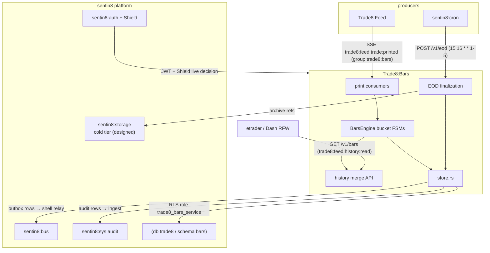
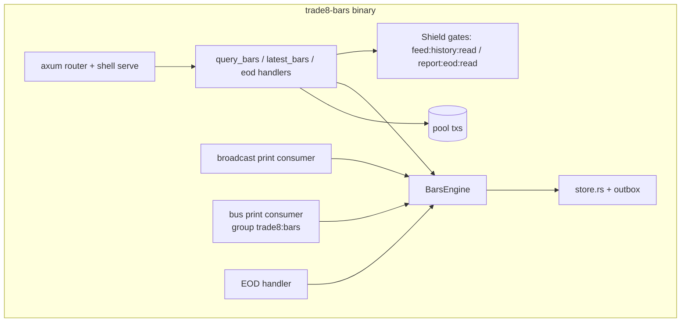
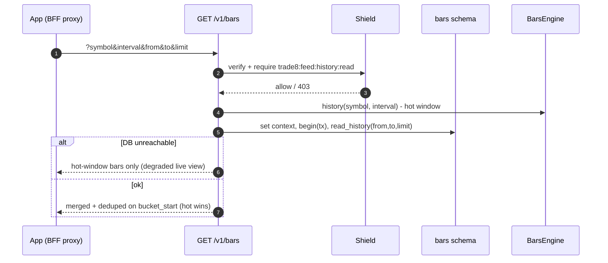
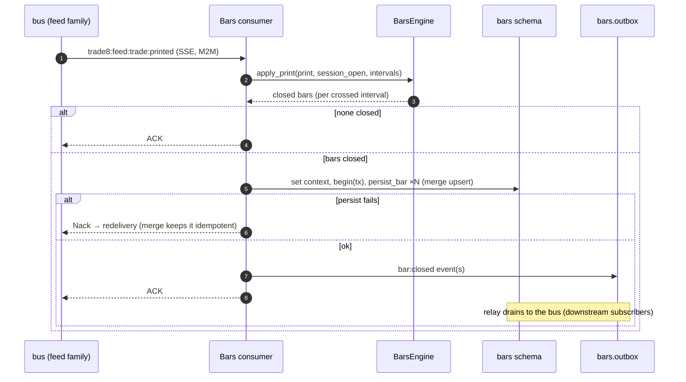
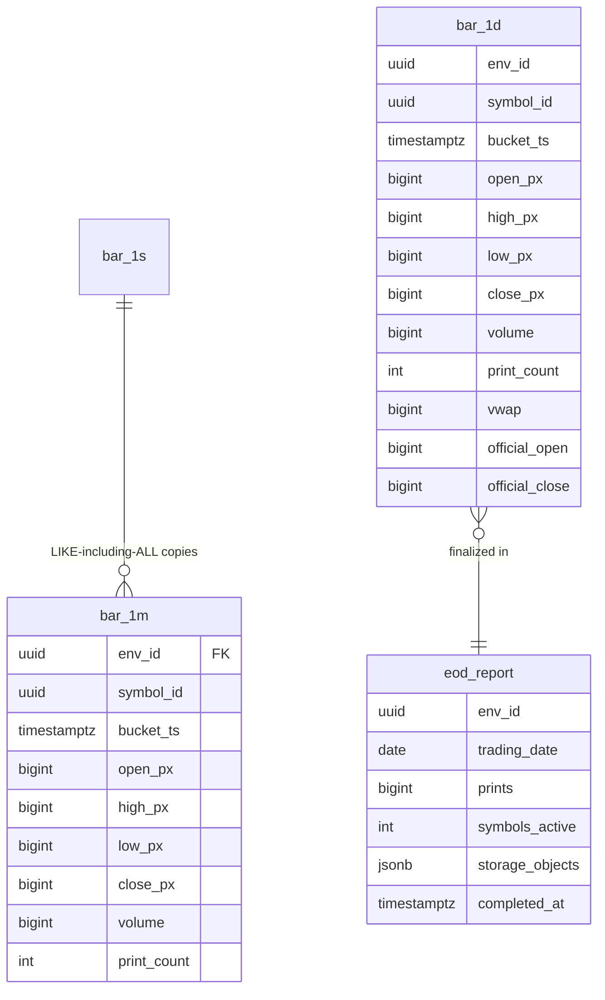
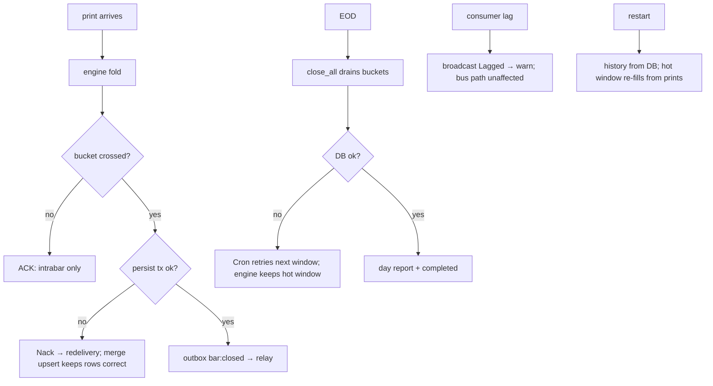
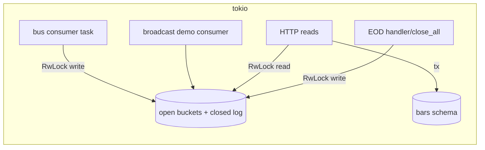
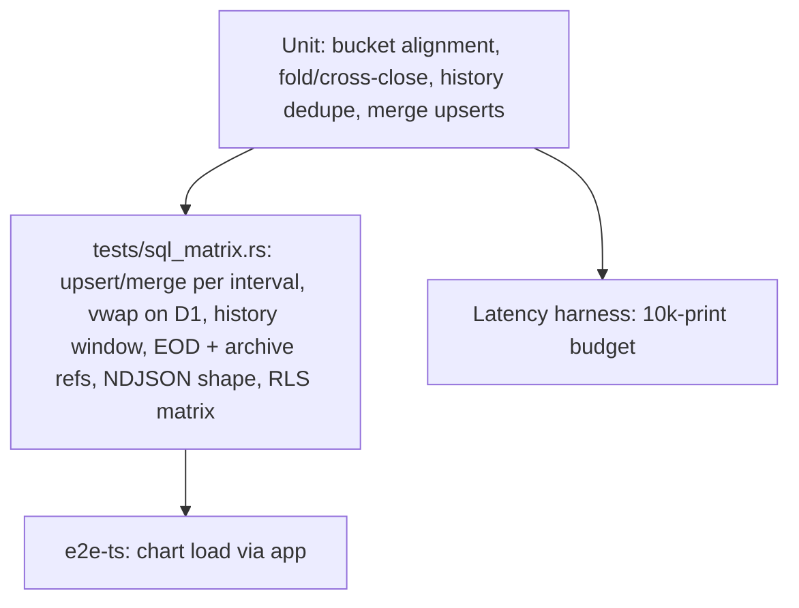

# Trade8:Bars - Detailed Design Document

> Audience: maintainers, reviewers, and architects modifying the service.
> Overview in `README.md`; business functionality in `BUSINESS.md`.

## 1. Scope & Context

**Owns**:

- OHLCV aggregation of trade prints and the bar history (schema `bars` in
  db `trade8`: `bar_1s`, `bar_1m`, `bar_5m`, `bar_15m`, `bar_1h`, `bar_1d`,
  `eod_report`, + shell-generated `bars.outbox`, `bars.audit_journal`).
- The EOD finalization pass and day report; the `bars` event family
  (`trade8:bars:*`).

**Does NOT own** (delegates):

- Prints/quotes → **Trade8:Feed** (Bars is a consumer).
- Session calendar / trading dates → **Trade8:Desk** (via calendar tables;
  the anchor wiring is an open item).
- Cold-object storage → **Sentin8:Storage** (object refs in `eod_report`).
- Scheduling (EOD finalize) → **Sentin8:Cron**.
- Chart rendering/indicators → the app (`etrader`).

## 2. Runtime Architecture

### Request lifecycle - history query family

### Consumer lifecycle - print → buckets → closed bar → persist

## 3. Data Model

Schema `bars`, db `trade8`; role `trade8_bars_service`; RLS env block on
all tables; shell-generated outbox/journal; no cross-schema grants.

- `bar_1s` is the shape base; `bar_1m/5m/15m/1h` are `CREATE TABLE (LIKE
  bar_1s INCLUDING ALL)`; `bar_1d` adds vwap + official open/close.
- PK (env, symbol, bucket_ts); the store's upsert merges high/low and
  accumulates volume/print_count (idempotent under redelivery).
- `eod_report.storage_objects` - references to cold-tier Storage objects
  (`trade8/bars/{env}/{symbol}/{interval}/{month}` columnar batches,
  designed archive path).

## 4. API Surface

### Public (BFF-proxied, JWT bearer)

| Endpoint | Gate | Notes |
|---|---|---|
| `GET /v1/bars` | `trade8:feed:history:read` | symbol+interval required; from/to/limit; DB+hot merge |
| `GET /v1/bars/latest` | `trade8:feed:history:read` | intrabar snapshot (running candles) |
| `GET /v1/eod` | `trade8:report:eod:read` | day-report list |
| `POST /v1/eod` | `trade8:report:eod:read` (cron-run mirror) | EOD finalize (Cron proxy-back) |

### Admin (RFW `GET /v1/admin/ui/{page}`)

| Page | Data endpoint |
|---|---|
| `coverage` | `GET /v1/admin/coverage` (symbols × intervals × last-bar age) |
| `eod` | `GET /v1/admin/eod` (report history) |

Plus the shared Shield policy-admin API block.

### Events

| Direction | Event | Trigger |
|---|---|---|
| Emitted | `trade8:bars:bar:closed` | a bucket crosses into the next (persist tx) |
| Emitted | `trade8:bars:eod:completed` | EOD finalize (persist tx) |
| Consumed | `trade8:feed:trade:printed` | roll-up path (group `trade8:bars`) |

(Outbox → relay → consumer flow shown in §2.)

## 5. Cross-Cutting Concerns

- **AuthN/AuthZ** - 8-step pipeline; Shield targets
  `trade8:feed:history:read` / `trade8:report:eod:read` (bars shares the
  feed's history scope by design - chart entitlement == history entitlement).
- **Tenant + RLS** - `set_tenant_context` + `begin()` on every DB leg;
  explicit env filters; no cross-schema access (bars is self-contained).
- **Idempotency** - bar upserts merge (idempotent under redelivery);
  outbox rows keyed by row id; EOD finalize is idempotent per date.
- **Audit journaling** - same-tx audit rows; Sys ingest with retry.
- **TLS/M2M** - post-quantum TLS; cert-bound consumer workloads
  (`trade8:bars`, `-admin/-policy/-tls` grants).
- **Scheduling** - EOD finalize registered via `sentin8::client::cron`
  (`15 16 * * 1-5` → `POST /v1/eod`).

## 6. Failure Modes & Recovery

- **Consumer failure mid-persist** → Nack/redelivery; merged upserts make
  reapplication safe.
- **EOD Cron retry** → persist is per-bar idempotent; a partially finalized
  day completes on retry; the report upserts by date.
- **Restart** → DB history is authoritative; the hot window re-warms from
  live prints (closed bars already durable).
- **Print burst → backpressure** - the engine holds open buckets in memory;
  closed-bar persistence batches per print batch. The broadcast consumer
  logs `Lagged` (demo path); the bus consumer redelivers from the stream.

## 7. Concurrency & Performance Model

- The engine is two `RwLock` maps (open buckets, closed log); the print fold
  is O(intervals) per print with pure numeric updates.
- Latency harness (`main.rs`): 10k-print roll-up budget; CI headroom
  asserted, design numbers release-measured.
- Pool: two short tx paths (bar persist, history read) - capped pool.
- Backpressure: bounded broadcast channel for the demo fan-out; the bus
  consumer relies on stream redelivery.

## 8. Invariants, Insecure-Defaults Rejected, Unsafe Rationale

1. Bars derive only from prints - no manual adjustment path exists in the
   service (corporate actions are another vertical's domain).
2. A bucket's OHLCV merges monotonically (high only rises, low only falls,
   volume accumulates) - idempotent rewrites.
3. History responses never contain duplicate buckets; the hot window wins
   on conflict.
4. All prices/volumes are integers (×10⁴ prices) - no float in the bar
   path; `bar_1d.vwap` at money scale.
5. The EOD report is written once per (env, date) (upsert semantics).
6. No `unsafe` blocks.

## 9. Testing Strategy

- Unit: boundary exactness (print at a boundary vs 1ns before), market-clock
  buckets, volume sums, ×10⁴ integrity.
- `tests/sql_matrix.rs` (skip-offline): RLS matrix; bar upsert/merge across
  intervals incl. D1 vwap; history window (close rides tuple index 4); EOD +
  archive refs; NDJSON export shape.
- Deliberately not tested here: feed producer guarantees (Feed), chart UX
  (apps design), Storage archive round-trip until the cold-tier loop lands.

## 10. Open Questions

- Session-open anchor wiring (per-day Cron reset vs calendar read).
- Cold-tier archive/rehydrate end-to-end (Storage object format + LRU).
- Per-env active-interval configuration (1m/5m/1d fixed today).
- Official open/close policy for no-print sessions.
- Registration declares `/v1/admin/bars` (implemented as `/v1/admin/coverage`)
  - align the declaration.

---

**Architecture & Design:** trade8:bars and its underlying concepts were designed by [Hamid Jahanzad](https://www.linkedin.com/in/hamidjahanzad/).

