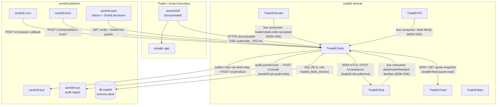
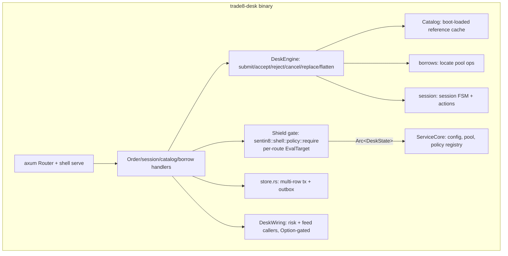
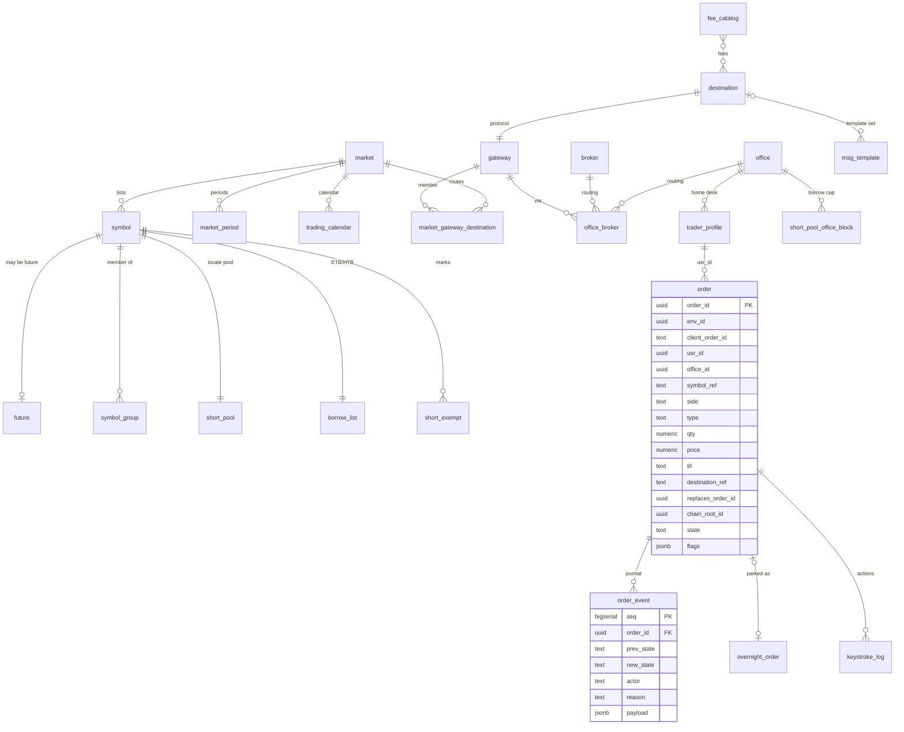
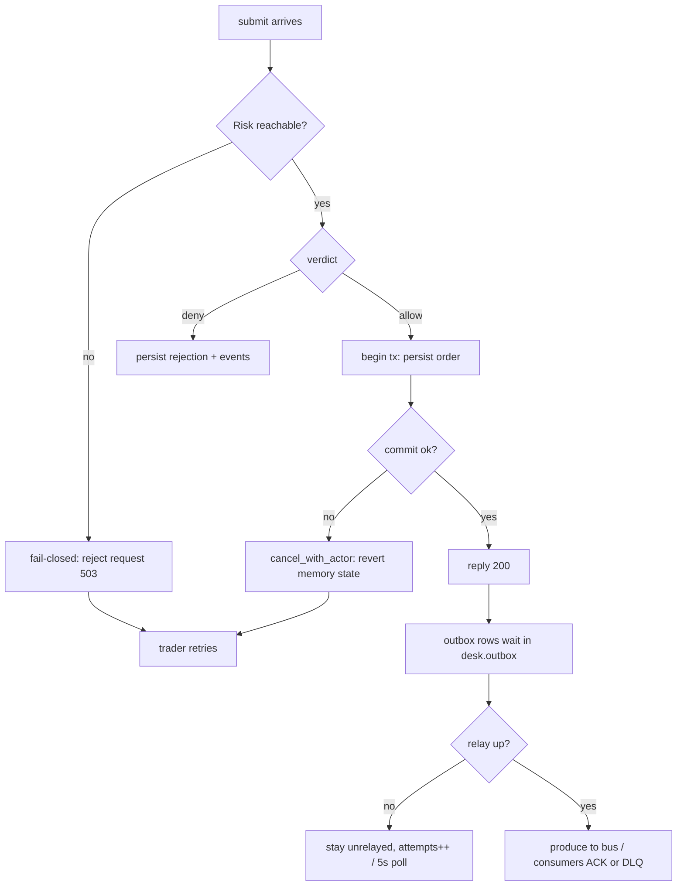
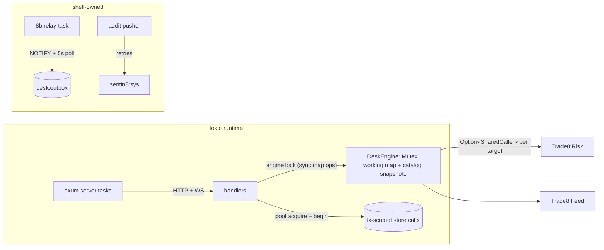

# DESIGN.md: Trade8:Desk — Detailed Design Document

> Audience: maintainers, reviewers, and architects modifying the service.
> Overview in `README.md`; business functionality in `BUSINESS.md`.

## 1. Scope & Context

**Owns** (resources, tables, event families):

- The order lifecycle and its working state; the append-only transition journal
  (`desk.order_event`); overnight parking (`desk.overnight_order`); keystroke
  audit (`desk.keystroke_log`).
- The trade8 reference catalogs (db `trade8`, schema `desk`): `market`,
  `symbol`, `future`, `symbol_group`, `tick_rule`, `market_period`,
  `trading_calendar`, `asset_class`, `currency`, `destination`, `gateway`,
  `market_gateway_destination`, `office`, `office_broker`, `broker`,
  `execution_rule`, `order_class`, `trader_profile`, `fee_catalog`,
  `reject_code`, `msg_template`, `sequence`.
- The short-sale locate pool: `short_pool`, `short_pool_office_block`,
  `borrow_list` (ETB/HTB), `short_exempt`.
- The `desk` event family (`events::FAMILY_DESK = "desk"`) with the
  `trade8:desk:*` event types.

**Does NOT own** (delegates):

- Pre-trade authorization math → **Trade8:Risk** (Desk calls
  `POST /v1/authorize`, fail-closed).
- Broker connectivity, FIX/OUCH sessions, fills, fees → **Trade8:Router**.
  Fills live in `router.order_transaction`; Desk learns about fills via events.
- P&L → **Trade8:Pnl** (consumes desk/router/feed events).
- Market data → **Trade8:Feed** (Desk reads snapshot BBO for flatten pricing).
- Scheduling → **Sentin8:Cron** (`sentin8::client::cron::default_schedules`:
  preopen `0 4 * * 1-5`, open `30 9`, close-pending `55 15`, close `0 16`).
- WASM strategy execution → **Sentin8:Func** (Desk hosts proxy-back
  `/v1/internal/func-host/*` for strategy modules).
- Identity, tokens, M2M certs → **Sentin8:Auth/Shield** (platform shell).



## 2. Runtime Architecture



### Request lifecycle — order submit (the authoritative family)

```mermaid
sequenceDiagram
    autonumber
    participant T as Trader (BFF proxy)
    participant D as Desk handler
    participant S as Shield (policy)
    participant E as DeskEngine
    participant R as Trade8:Risk (M2M mTLS)
    participant DB as db trade8 / desk
    participant O as desk.outbox

    T->>D: POST /v1/orders (JWT bearer)
    D->>S: verify token + policy require trade8:desk:order:write (live roles)
    S-->>D: allow/deny
    D->>E: submit_pending (structural checks) → Pending order
    D->>R: authorize(AuthorizeRequest, Intent::Open)
    alt Risk unreachable
        R--xD: connection error → fail-closed → 503, nothing persisted
    else deny
        R-->>D: verdict deny + trace
        D->>E: reject_pending(code)
        D->>DB: set context; tx: order row (rejected) + order_event + outbox(order:rejected) + audit
        D-->>T: 422 {code, message, params}
    else allow
        R-->>D: verdict allow + remaining_buying_power
        D->>E: accept_pending (locate reserve if short)
        D->>DB: set context; begin(); persist_order_accepted (order + transition + outbox submitted/accepted + borrow) single tx
        D-->>T: 200 {order_id, state, remaining_buying_power}
        Note over O,DB: relay later drains outbox rows → bus consumers (Router/Risk/Pnl)
    end
```

### Batch submit, flatten, and session choreography

```mermaid
sequenceDiagram
    autonumber
    participant C as Caller (BFF / Cron / Func)
    participant D as Desk
    participant R as Risk
    participant DB as DB
    C->>D: POST /v1/orders/batch (BasketRequest)
    loop per item (skip none; per-item risk)
        D->>R: authorize(intent Open) for each item
        D->>DB: per-item persist tx (accepted/rejected + events + outbox)
    end
    D-->>C: per-item statuses (per-item not all-or-none)
    C->>D: POST /v1/positions/flatten (FlattenRequest, strategy params)
    D->>DB: emit trade8:desk:order:flatten (outbox) — trigger: Sentin8:Func flexible-flat via vertical-registry event_triggers
    C->>D: POST /v1/session {action: open|close|close_pending|preopen}
    D->>DB: session FSM event + outbox(trade8:desk:session:state)
    alt action = close
        D->>DB: park overnight-TIF orders to desk.overnight_order; cancel day-TIF remnants
    end
```

## 3. Data Model

Schema `desk` in database `trade8` (database-per-vertical, schema-per-service;
role `trade8_desk_service`, RLS enabled+forced on every table). All tables carry
`env_id UUID NOT NULL`; the standard 4-policy RLS DO-block matches
`sentin8_context_initialized() AND env_id = sentin8_current_env_id()`.
Outbox + audit journal DDL is shell-generated
(`sentin8-outbox::outbox_table_sql("desk")`, `sentin8-audit::audit_journal_sql("desk")`).



- `symbol` carries feed_state (active/inactive), price limits, fix_tags,
  avg volume; `future` adds expiry/settle/price_scale.
- `destination` holds protocol (`fix42|fix44|ouch31`), `credentials_ref`
  (secret **reference**, never plaintext), visibility (`B|D|H`), heartbeat,
  seq-reset policy — router reads it via declared cross-schema grants.
- `trader_profile` is keyed by the Auth user id (`usr_id PK = sentin8 sub`).
- `sequence` holds env-wide counter conventions for lease-style allocation.

## 4. API Surface

### Public (BFF-proxied, JWT bearer; Shield gate per action)

| Endpoint | Purpose | Shield eval target | Events emitted (outbox) |
|---|---|---|---|
| `POST /v1/orders` | Submit order (idempotency required) | `trade8:desk:order:write` | `trade8:desk:order:submitted`, `::accepted`, `::rejected` |
| `POST /v1/orders/batch` | Basket submission (per-item risk) | `trade8:desk:order:write` | per-item `::submitted/accepted/rejected` |
| `GET /v1/orders` | Blotter (scope-filtered) | `trade8:desk:order:read` | — |
| `GET /v1/orders/{id}` | Order detail | `trade8:desk:order:read` | — |
| `DELETE /v1/orders/{id}` | Cancel | `trade8:desk:order:cancel` | `::cancelled` |
| `POST /v1/orders/{id}/replace` | Cancel-replace (new order id) | `trade8:desk:order:write` | `::cancelled` (old), `::submitted/accepted` (new) |
| `POST /v1/positions/flatten` | One-click flatten | `trade8:desk:order:flatten` | `::flatten` (Func trigger), then normal submit flow |
| `GET /v1/session` · `POST /v1/session` | Session state / action | `trade8:market:session:manage` | `trade8:desk:session:state` |
| `GET /v1/symbols` | Instrument catalog | `trade8:desk:order:read` | — |
| `GET /v1/borrow` · `POST /v1/borrow` | Locate pool read/mutation | `trade8:risk:borrow:read` / `trade8:risk:borrow:write` | `trade8:desk:borrow:updated` |
| `GET /ws` | Two-way order entry channel (upgrade) | `trade8:desk:order:write` | same as REST path |

### Cron proxy-back (Sentin8:Cron schedules)

| Endpoint | Purpose | Schedule |
|---|---|---|
| `POST /v1/session` | preopen/open/close-pending/close actions | `0 4 * * 1-5`, `30 9`, `55 15`, `0 16` (via `sentin8::client::cron::default_schedules("desk", port)`) |

### Internal (proxy-back from Sentin8:Func strategy modules)

| Endpoint | Purpose |
|---|---|
| `POST /v1/internal/func-host/orders` | `submit_order(on behalf of trader)` — flexible-flat/basket-runner |
| `POST /v1/internal/func-host/orders/{id}/cancel` | `cancel_order(on behalf)` — flexible-flat attempt loop |
| `GET /v1/internal/func-host/orders/{id}` | order snapshot for strategy hooks |

Gates: `trade8:func:host` + the M2M workload's declared scopes; every mutation
journals an actor of the form `strategy:{module}`.

### Admin (RFW renderer — `GET /v1/admin/ui/{page}` + data endpoints)

| Page | Data endpoint(s) |
|---|---|
| `overview` | `GET /v1/admin/overview` |
| `orders` | `GET /v1/admin/orders` |
| `symbols` | `GET /v1/admin/symbols` |
| `markets` | `GET /v1/admin/markets` |
| `destinations` | `GET /v1/admin/destinations` |
| `offices` | `GET /v1/admin/offices` |
| `borrow` | `GET /v1/admin/borrow` |
| `session` | `GET /v1/admin/session`, mutations via RFW POST aliases mounted by the shared policy-admin block |

Plus the platform-wide Shield policy-admin API (`/v1/admin/policy-sets`,
`/v1/admin/relations`, `/v1/admin/attributes`), mounted identically on all six
trade8 services.

### Event flow (outbox → bus → triggers)

```mermaid
sequenceDiagram
    autonumber
    participant H as Desk handler/persist
    participant O as desk.outbox
    participant REL as Shell relay (boot-step 8b)
    participant B as sentin8:bus
    participant ROUTER as Trade8:Router consumer
    participant RISK as Trade8:Risk consumer
    participant PNL as Trade8:Pnl consumer
    participant F as sentin8:func flexible-flat
    H->>O: insert_outbox_row(env, "desk", "trade8:desk:order:accepted", payload) [same tx]
    REL->>O: SELECT unrelayed rows (NOTIFY desk_outbox_changed + 5s poll)
    REL->>B: POST /v1/produce (M2M trade8:desk, sentin8:bus:produce, idempotency_key=row id)
    B->>ROUTER: SSE consume (group trade8:router, filter ::order:accepted) → ACK
    B->>RISK: SSE consume (group trade8:risk:desk, filters accepted/cancelled/rejected/replaced/routed) → ACK
    B->>PNL: SSE consume (group trade8:pnl:desk, filters session:state, order:overnight:restored) → ACK
    B->>F: declarative trigger (vertical-registry event_triggers) on ::order:flatten → on_flatten hook
    Note over B,PNL: consumer failure → Nack → redelivery; poison → DLQ + manual replay
```

## 5. Cross-Cutting Concerns

- **Authentication & authorization** — platform 8-step pipeline: `verify_token`
  (issuer/expiry/audience/type) → tenant resolution → feature gate → Shield
  (`sentin8-policy`) live-role decision (`trade8:desk:*` + ReBAC + ABAC
  attributes) → RLS context → handler → audit. No `scope`-only checks.
- **Tenant resolution + RLS** — `set_tenant_context(&mut conn, env)` then
  `conn.begin()`; data SQL runs on the *same* transaction (context is
  transaction-local). Every store query filters `env_id` explicitly as
  defense-in-depth. RLS `ENABLE`+`FORCE` on all tables; role
  `trade8_desk_service` has no BYPASSRLS.
- **Idempotency** — `client_order_id`/idempotency-key dedupe at submit;
  bus events carry idempotency keys (outbox row id); consumers dedupe.
- **Audit journaling** — `desk.audit_journal` rows in the same tx as domain
  changes; pushed to Sys ingest (`POST /v1/audit`, `sentin8:sys:audit:write`)
  with retries — a Sys outage never drops audit.
- **Rate limiting / bot protection** — delegated to the BFF edge + Shield
  ABAC attributes (e.g. max-orders rate limits enforced in Risk domain logic).
- **Graceful drain** — shell `upgrade-instance` drains in-flight requests
  before swap (platform contract); no Desk-specific drain state.
- **TLS posture** — post-quantum TLS everywhere via `sentin8-tls` (X25519MLKEM768,
  ML-DSA-65); service M2M is certificate-bound; no classical fallback.

## 6. Failure Modes & Recovery

- **Risk unreachable at submit** → fail-closed: the pending order is never
  accepted; the handler returns an error (503 mapping) and the engine drops
  the pending state. The trader retries; idempotency prevents duplicates.
- **Persist failure after accept (DB error)** → the engine cancels the accepted
  state (`cancel_with_actor("system:persist-fail")`) so memory and DB never
  diverge; the request fails.
- **Outbox relay outage** → rows remain `unrelayed` in `desk.outbox` with
  attempt counters; the relay polls every 5s and on `NOTIFY`, so delivery is
  at-least-once after recovery. Downstream consumers dedupe on idempotency keys.
- **Consumer failure on an accepted order event** → Nack → redelivery; after
  retry exhaustion the event lands in the bus DLQ (`GET /v1/dlq`) for manual
  replay — order state in Desk remains correct because the journal is local.
- **Process crash** → journal is durable; session rebuild replays
  `desk.order_event` for working-state recovery; parked `desk.overnight_order`
  restores at session preopen.
- **Pool saturation** → `sentin8_config::pg_pool::connect` caps pool
  connections (`SENTIN8_PG_POOL_MAX`), preventing cross-service starvation on
  the shared cluster.



## 7. Concurrency & Performance Model



- **Task layout** — one axum server task set + the shell's relay/audit tasks;
  no bespoke background loops (session timers are Cron, not in-process).
- **Locking** — the engine's working map is guarded by a std mutex held across
  pure in-memory operations only (no `.await` under lock, no I/O under lock);
  catalog reads are snapshot-based, no lock on hot reads.
- **Pool** — `max_connections` capped at 3 × instances via the shared helper;
  every store call is tx-scoped, so a request holds ≤1 connection.
- **Hot paths** — submit (validate → authorize → 1 tx), cancel, WS order
  entry; blotter paging reads the DB with a bounded `limit`.
- **Backpressure** — WS frames and bus-consumer dispatch use bounded queues
  (`OutboundStream`/`QueueFull` in `trade8-client`) so slow clients cannot
  stall the engine.

## 8. Invariants, Insecure-Defaults Rejected, Unsafe Rationale

1. `desk.order_event` is append-only; no UPDATE/DELETE path exists.
2. State in memory never diverges from the journal: accept-without-persist and
   persist-without-accept are both impossible (single tx + engine revert).
3. Every short accept reserves locate *before* reply; every terminal transition
   releases it.
4. Tenant context is set per request and pinned to the same tx as the data; a
   request without a resolvable env context is rejected, never defaulted.
5. `credentials_ref` (destination secrets) is stored by reference only —
   plaintext provider credentials are never inserted by Desk.
6. No `unsafe` blocks in the service. The engine's `OrderState::can_transition`
   table is the sole authority for transitions.

## 9. Testing Strategy

```mermaid
graph TD
    U[Unit: engine state machine, borrow math, catalog parsing — in-file #[cfg test]] --> I[Integration: tests/sql_matrix.rs — real DB, service role + trade8_probe]
    I --> P[Policy: tests/policy.rs — Shield engine vs declared policy seed]
    I --> E2E[E2E: e2e-ts UI via BFF proxy — submit → blotter → cancel]
    P --> L[Latency harness: submit/cancel P50 budget in-file]
```

- **Unit** (in `src` + crates): legality table, borrow arithmetic at ×10⁴
  scale, catalog loader, reject-code mapping.
- **`tests/sql_matrix.rs`** (service role `trade8_desk_service`, offline-skip):
  RLS matrix (no-context/cross-env → 0 rows), `persist_order_accepted`
  triple-write atomicity, transition journal ordering, overnight
  park→load→restore round-trip, blotter scope filter, borrow bootstrap/mutation,
  catalog bootstrap.
- **`tests/policy.rs`**: no-set → deny; shadow never blocks; enforce → 403 +
  Stat; M2M parity; hot reload; live-role freshness; mirror-covers-actions parity.
- **`tests/flow.rs`** (tree-layout-only, `--features cross_repo_flows`):
  the cross-service flow tests with the Risk test double
  (`src/risk_double.rs`). The double embeds Risk's REAL engine core
  (`trade8-risk/src/core.rs`) via `include!` inside a feature-gated inline
  `mod` — the include path is opaque to rustfmt (single-repo CI's blocking
  fmt gate stays green) and resolves only when the feature is on, which
  requires the aggregation-tree layout (trade8-risk checked out side by
  side). A single-repo `cargo test` runs 0 tests from this target.
- Deliberately **not** tested here: Router broker wire behavior (Router design),
  limit math (Risk), bus delivery guarantees (platform bus tests), Flutter UX
  (apps design).

## 10. Open Questions

- Replication semantics for catalogs across envs (single catalog-owner env vs
  per-env copies reconciled by events) is unresolved.
- Long-lived WS sessions during failover: whether the drain window should force
  client reconnect-and-resync uniformly (BFF contract) is still a platform topic.
- Whether flatten attempt loops should always run through Cron-scheduled timers
  (vs the current bounded in-process ladder) at higher order volumes.
- `trade8:desk:order:batch-requested` is declared as an event trigger in
  `vertical-registry.json` but Desk submits batches synchronously today — the
  async batch-trigger contract is a candidate for either full removal or full
  adoption (no in-between), pending product decision.

---

**Design attribution:** trade8:desk and its underlying concepts were designed by Hamid Jahanzad <Hamid@Jahanzad.com>.

