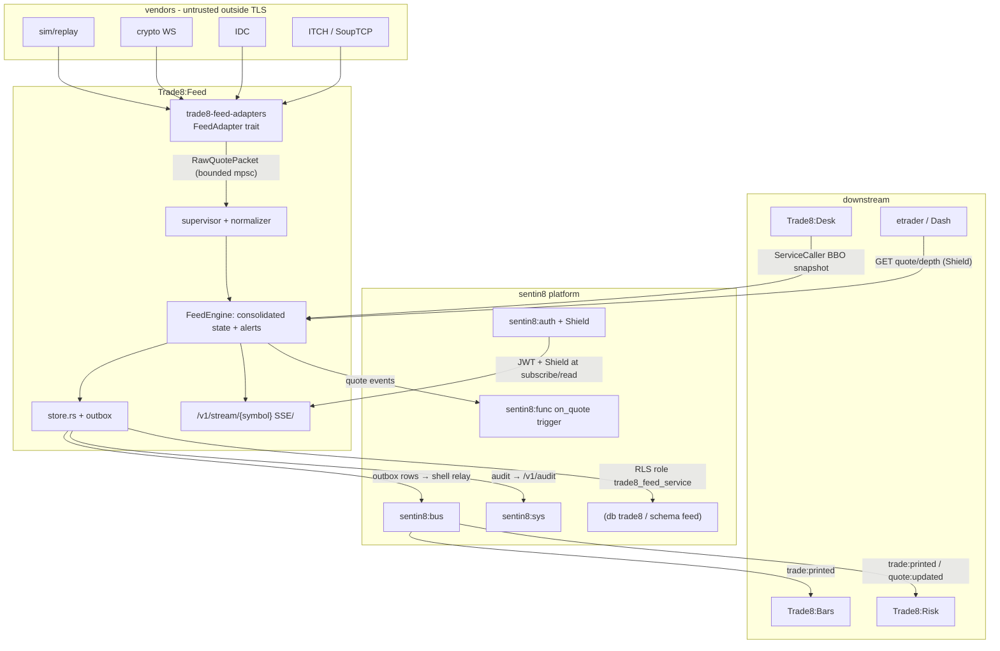
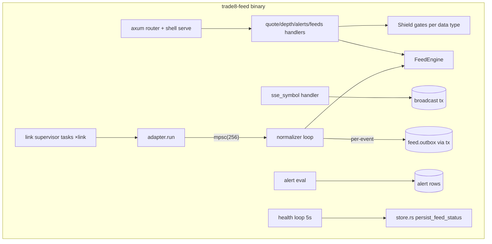
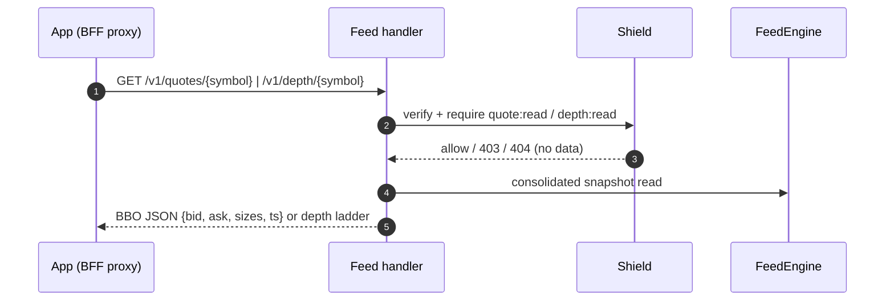
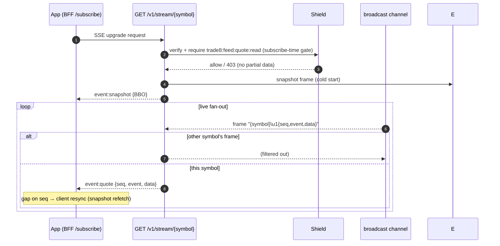
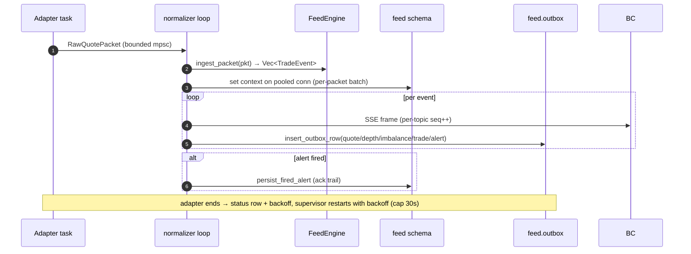
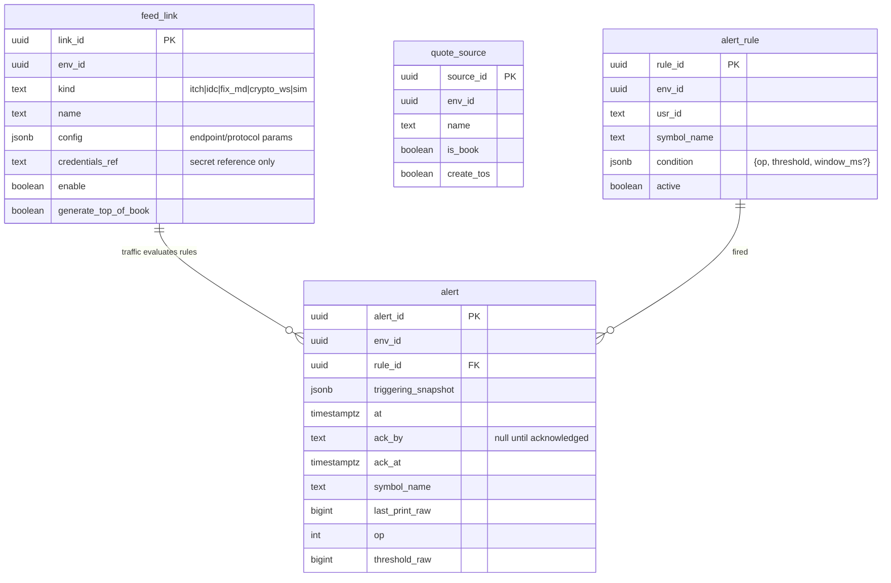
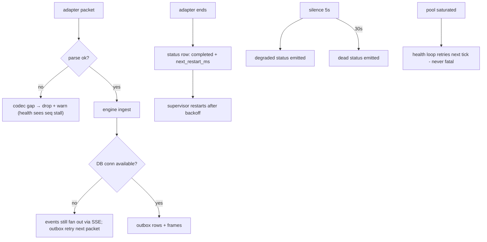
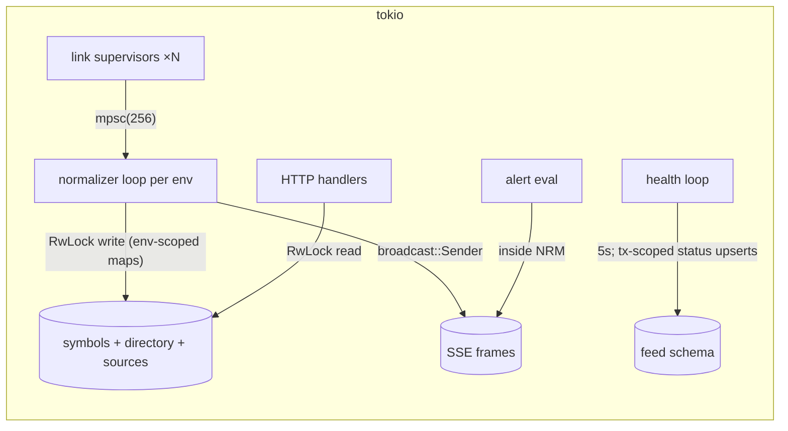
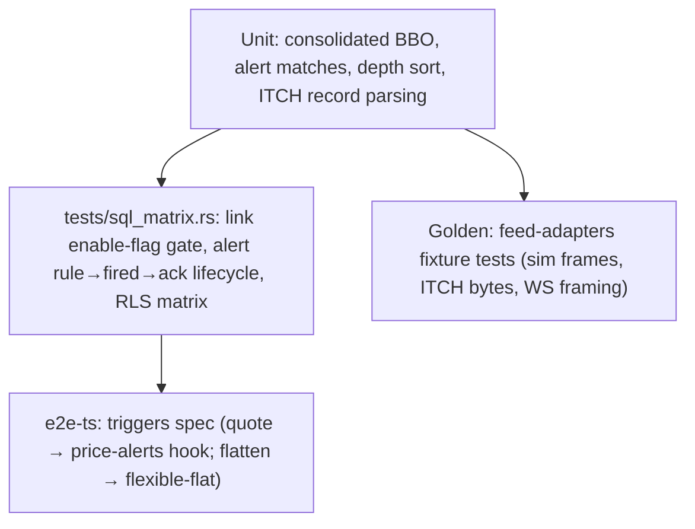

# Trade8:Feed - Detailed Design Document

> Audience: maintainers, reviewers, and architects modifying the service.
> Overview in `README.md`; business functionality in `BUSINESS.md`.

## 1. Scope & Context

**Owns**:

- Vendor-feed ingestion (adapter supervision), normalization, and
  consolidation state (per-symbol L1/L2/imbalance/prints).
- Price-alert rules + fired alerts + ack trail (`feed.alert_rule`,
  `feed.alert`), feed-link configuration (`feed.feed_link`,
  `feed.quote_source`), feed-health records, schema `feed` outbox/journal,
  the `feed` event family (`trade8:feed:*`), and the SSE quote stream.

**Does NOT own** (delegates):

- Bars history → **Trade8:Bars** (consumes prints).
- Vendor symbol/instrument reference → **Trade8:Desk** (`symbol` catalog;
  the directory maps vendor symbols onto them).
- Order flow → Desk/Router. Risk → Trade8:Risk.
- Complex tenant-authored alert logic → **Sentin8:Func** (`on_quote`).
- Multicast egress → out of scope (venue-side concern if ever needed).

## 2. Runtime Architecture

### Request lifecycle - snapshot read family

### Subscription lifecycle - SSE stream family

### Normalizer/ingest lifecycle (adapter → events → bus)

## 3. Data Model

Schema `feed`, db `trade8`; role `trade8_feed_service`; RLS env block;
shell-generated outbox/journal; **no cross-schema grants** (the engine
resolves symbols from its own directory + Desk catalog via events/wiring,
not SQL).

- `alert_rule.condition` - JSONB `{op, threshold, window_ms?}` (declarative
  conditions; engine matches on the rule's typed copy).
- `alert.ack_by/ack_at` - the acknowledge trail (admin page acks).
- No secret columns: `credentials_ref` references the platform secret store.

## 4. API Surface

### Public (BFF-proxied, JWT bearer)

| Endpoint | Gate | Notes |
|---|---|---|
| `GET /v1/quotes/{symbol}` | `trade8:feed:quote:read` | consolidated L1 snapshot |
| `GET /v1/depth/{symbol}` | `trade8:feed:depth:read` | top-N ladder |
| `GET /v1/alerts` · `POST /v1/alerts` | `trade8:feed:quote:read` | self rules |
| `GET /v1/feeds` | `trade8:feed:manage` | link wall config |
| `GET /v1/stream/{symbol}` (SSE) | `trade8:feed:quote:read` | snapshot frame + live frames, per-symbol filter, per-topic seq |

### Admin (RFW `GET /v1/admin/ui/{page}`)

| Page | Data endpoint |
|---|---|
| `feeds` | `GET /v1/admin/feeds` (link wall) |
| `sources` | `GET /v1/admin/sources` |
| `alerts` | `GET /v1/admin/alerts`; ack via `GET|POST /v1/admin/alerts/{id}/ack` (RFW POST-alias) |

Plus the shared Shield policy-admin API block.

### Events

| Direction | Event | Trigger |
|---|---|---|
| Emitted | `trade8:feed:quote:updated` | BBO packet normalized |
| Emitted | `trade8:feed:depth:updated` | level update |
| Emitted | `trade8:feed:imbalance:updated` | auction snapshot |
| Emitted | `trade8:feed:trade:printed` | consolidated print |
| Emitted | `trade8:feed:alert:fired` | rule matched |
| Emitted | `trade8:feed:feed:status` | link state transition |
| Consumed | `trade8:feed:quote:updated` (Func trigger: `trade8-price-alerts`) | tenant-authored complex conditions |

(Outbox → relay → consumers: see §2 lifecycle diagram.)

## 5. Cross-Cutting Concerns

- **AuthN/AuthZ** - 8-step pipeline; Shield targets per data type
  (L1 vs L2 vs manage); SSE entitlement is checked **at subscribe time** -
  subscribed clients keep frames until disconnect (no per-frame checks).
- **Tenant + RLS** - every store path sets context then tx; engine state is
  env-scoped by boot (`TRADE8_FEED_ENV`); explicit env filters in SQL.
- **Idempotency** - outbox rows carry idempotency keys (row ids); alert
  persistence keyed by rule+trigger; feed-status upserts by (link, at).
- **Audit journaling** - same-tx journal rows; admin mutations (links,
  rules, acks) audited; Sys push with retry.
- **Rate limiting / backpressure** - bounded mpsc from adapter to
  normalizer (256 packets); SSE per-frame broadcast with `Lagged`
  tolerance (frames coalesce naturally); adapter restart backoff capped
  30s.
- **Secrets/TLS** - `credentials_ref` secret references; post-quantum TLS;
  M2M cert-bound workloads (`trade8:feed` relay/consumer, `-tls`).

## 6. Failure Modes & Recovery

- **Adapter crash/disconnect** - supervisor records status, restarts with
  exponential backoff (cap 30s); the gap shows on the health wall.
- **Codec gaps** - unmatched records drop with a warn (never panic the
  engine); sequence gaps surface via the health status (retransmit where
  the protocol supports it).
- **DB outage** - SSE fan-out continues (memory state), outbox rows retry
  with the next packet's connection; alerts persist once the DB returns.
- **SSE client lag** - dropped frames are client-resynced via snapshot
  refetch; the server keeps no per-client cursor.

## 7. Concurrency & Performance Model

- One supervisor task per link (bounded channel); the normalizer loop is
  the single writer to engine state per env.
- Reads (snapshot API) take cheap `RwLock` read guards; hot quotes avoid
  clones where possible.
- SSE fan-out per symbol via broadcast filter (no per-subscriber work in
  the ingest path beyond one `send`).
- Pool: writes only (batched per packet), capped by the shared helper.
- Latency harness (60s budget for the 100k-quote ingest+fan-out budget, CI
  headroom; release-measured design number).

## 8. Invariants, Insecure-Defaults Rejected, Unsafe Rationale

1. Vendor bytes never pass the adapter boundary un-normalized; the engine
   API is packets-in, typed events-out.
2. Consolidated BBO ≥ per-source extremes: best bid = max across sources,
   best ask = min; sizes sum at the extremes (NBBO-style) - pinned by tests.
3. Alert rules match only on the last print; matching is total (no
   side effects; fired alerts persist before fan-out completes).
4. Entitlement rejection is total-per-topic: a subscriber lacking
   `depth:read` never receives any frame containing level data.
5. Vendor credentials exist only as secret references.
6. No `unsafe` blocks (the websocket handshake is hand-rolled but
   bounds-checked parsing); decode errors are typed (`AdapterError`), never
   panics on the ingest path.

## 9. Testing Strategy

- Unit: `SymbolQuotes::consolidated_bbo` (multi-source merge), alert
  matching ops, depth ladder ordering, packet parse paths.
- `tests/sql_matrix.rs` (skip-offline): RLS matrix; link enable-flag gate;
  alert rule → fired → ack lifecycle.
- `latency_harness.rs`: ingest+fan-out budget.
- Deliberately not tested here: vendor endpoints live-wire behavior (sim
  covers replay), Bars aggregation (Bars), BFF SSE transport (platform).

## 10. Open Questions

- **FIX-MD adapter production path** (currently sim-mapped) - which vendor
  first, and whether the session rides the FIX codec crate.
- **Symbol-directory auto-discovery** from vendor feeds vs admin-seeded
  mappings.
- **Imbalance REST snapshot** endpoint (state normalized; endpoint not
  routed yet).
- **Alert confirm-window semantics** (`window_ms`) - sustained-condition
  logic currently matches single prints; the windowed evaluation needs
  product confirmation.
- **Live intrabar/coalesced depth push** cadence for very active symbols
  (bounded SSE frames per second).

---

**Architecture & Design:** trade8:feed and its underlying concepts were designed by [Hamid Jahanzad](https://www.linkedin.com/in/hamidjahanzad/).

