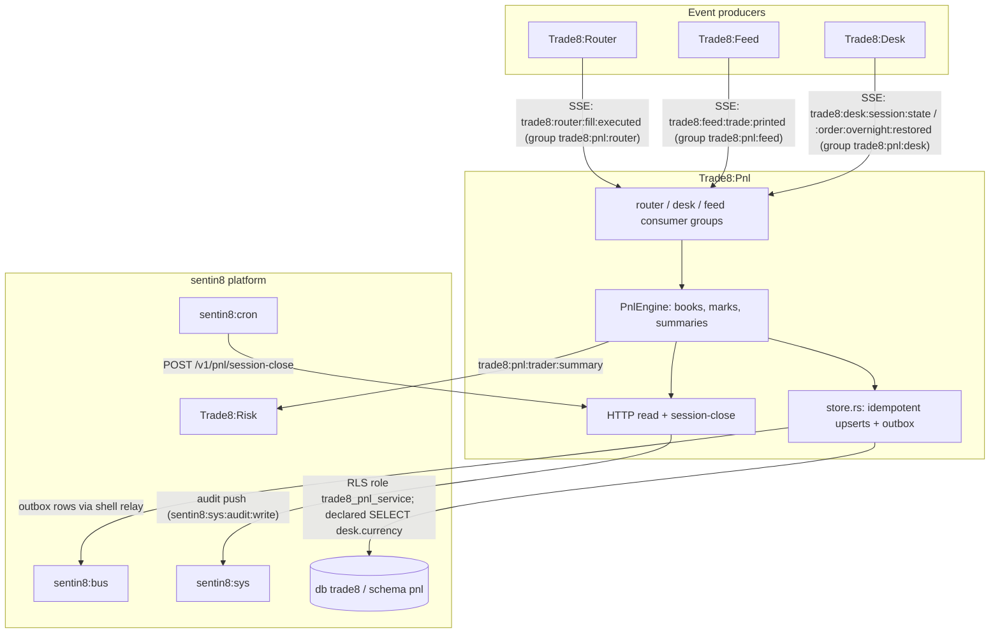
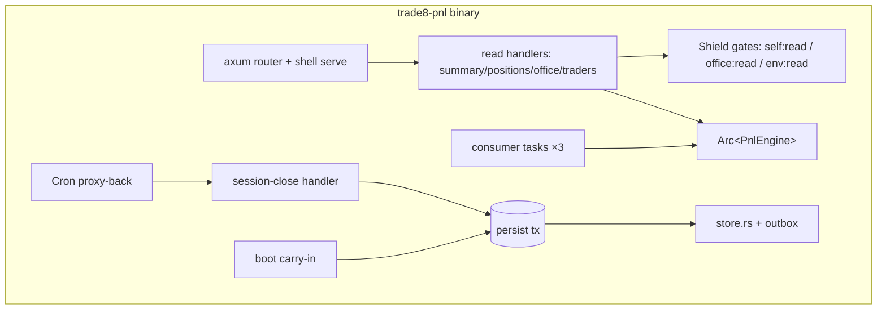
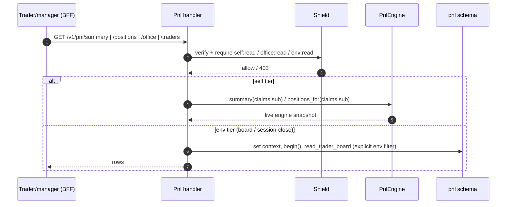
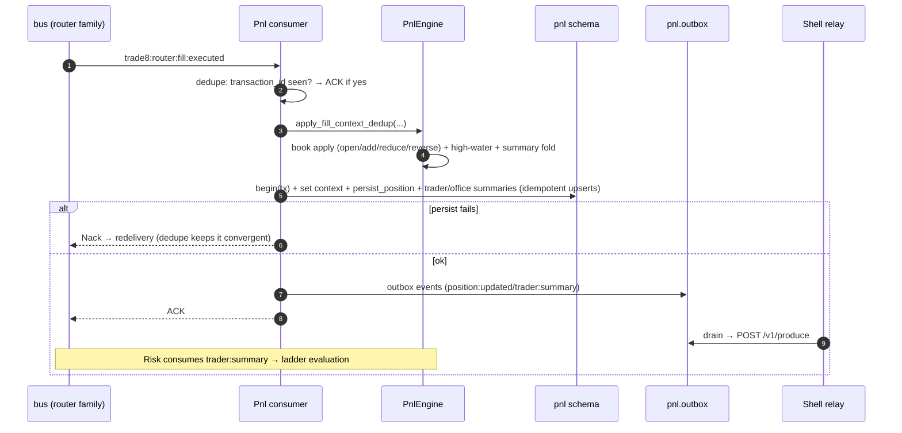
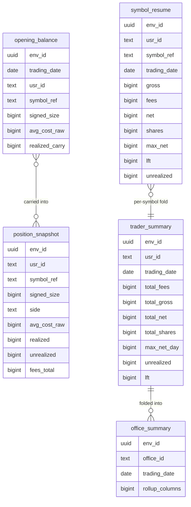
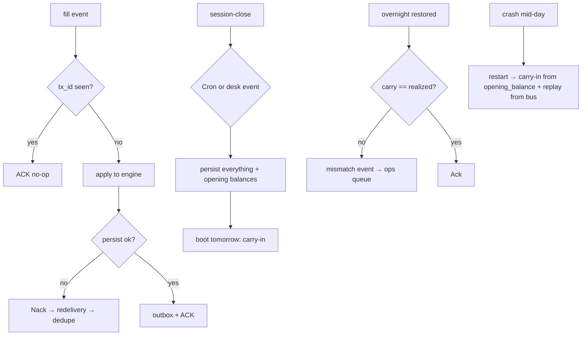
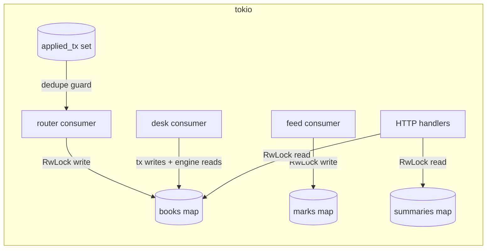
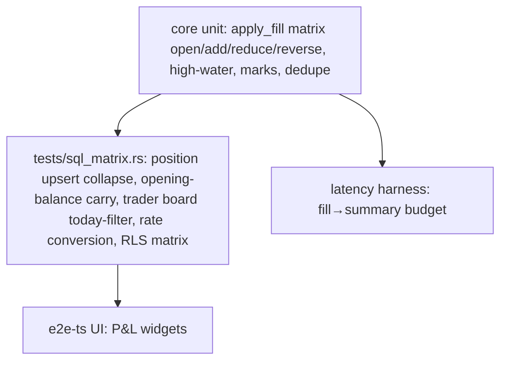

# DESIGN.md: Trade8:Pnl - Detailed Design Document

> Audience: maintainers, reviewers, and architects modifying the service.
> Overview in `README.md`; business functionality in `BUSINESS.md`.

## 1. Scope & Context

**Owns**:

- Derived financial state: positions, realized/unrealized P&L, fee totals,
  LFT/max-net trackers, per-trader and per-office day summaries, overnight
  carry and reconciliation.
- Tables (db `trade8`, schema `pnl`): `opening_balance`,
  `position_snapshot`, `symbol_resume`, `trader_summary`, `office_summary`
  (+ shell-generated `pnl.outbox`, `pnl.audit_journal`).
- The `pnl` event family (`events::FAMILY_PNL = "pnl"`) with
  `trade8:pnl:*` event types.

**Does NOT own** (delegates):

- Order state / overnight parking → **Trade8:Desk** (Pnl reconciles against
  it, never writes it).
- Fill/fee computation → **Trade8:Router** (Pnl accumulates reported fees).
- Marks/quotes → **Trade8:Feed** (consumes prints).
- Risk decisions → **Trade8:Risk** (Risk consumes Pnl summaries).
- Scheduling → **Sentin8:Cron** (`POST /v1/pnl/session-close`).

## 2. Runtime Architecture

### Request lifecycle - read family (self / office / env tiers)

### Consumer lifecycle - fill → position → summary → persist

## 3. Data Model

Schema `pnl`, db `trade8`; role `trade8_pnl_service`; RLS env block on all
tables; shell-generated outbox/journal; declared cross-schema grant:
`SELECT` on `desk.currency`.

- `opening_balance` - written at session close for **tomorrow**; loaded at
  boot (carry-in) by office membership.
- `position_snapshot` / `symbol_resume` / `trader_summary` /
  `office_summary` - live + day tables; idempotent upserts keyed by
  (env, trader, symbol, date).
- RLS tiers: reads are additionally scope-filtered by handler tier
  (self = `usr_id = token.sub`; office = member office; env = manager).
- No secret columns: Pnl holds numerics only.

## 4. API Surface

### Public (BFF-proxied, JWT bearer)

| Endpoint | Gate | Notes |
|---|---|---|
| `GET /v1/pnl/summary` | `trade8:pnl:self:read` | caller's day summary (live engine) |
| `GET /v1/pnl/positions` | `trade8:pnl:self:read` | caller's positions + marks |
| `GET /v1/pnl/office` | `trade8:pnl:office:read` | office roll-up (`?office_id`) |
| `GET /v1/pnl/traders` | `trade8:pnl:env:read` | all-trader board (DB truth) |
| `POST /v1/pnl/session-close` | `trade8:pnl:env:read` | Cron proxy-back persist pass |

### Admin (RFW `GET /v1/admin/ui/{page}`)

| Page | Data endpoint |
|---|---|
| `traders` | `GET /v1/admin/traders` (day P&L board) |
| `overnight` | `GET /v1/admin/overnight` (balances + mismatch queue) |

Plus the shared Shield policy-admin API block.

### Events

| Direction | Event | Trigger |
|---|---|---|
| Emitted | `trade8:pnl:position:updated` | fill applied (persist tx) |
| Emitted | `trade8:pnl:trader:summary` | summary recompute (persist tx) |
| Emitted | `trade8:pnl:office:summary` | office fold (persist tx) |
| Emitted | `trade8:pnl:overnight:mismatch` | restored-order carry divergence |
| Consumed | `trade8:router:fill:executed` | position/fill engine |
| Consumed | `trade8:feed:trade:printed` | marks +
 unrealized |
| Consumed | `trade8:desk:session:state` (closed) | session-close persist + carry |
| Consumed | `trade8:desk:order:overnight:restored` | overnight reconciliation |

(See the consumer/sequence diagrams in §2 for the outbox→bus flow; the
mismatch path lands in `pnl.outbox` exactly like the summary events.)

## 5. Cross-Cutting Concerns

- **AuthN/AuthZ** - 8-step pipeline; Shield targets `trade8:pnl:self/office/env:read`;
  the self tier additionally binds rows to `token.sub` in SQL.
- **Tenant + RLS** - `set_tenant_context` + `begin()`; explicit env filters;
  role `trade8_pnl_service` (no BYPASSRLS); declared `desk.currency` read only.
- **Idempotency** - engine dedupe set on fill `transaction_id`; DB upserts
  keyed by (env, trader, symbol/office, trading_date); outbox rows carry
  idempotency keys = row ids.
- **Audit journaling** - same-tx audit rows; Sys ingest with retry.
- **Fail-safety** - engine restarts rebuild from opening balances + new bus
  events (intrasession loss tolerated only for the replay gap - see §6).
- **TLS/M2M** - cert-bound consumers (`trade8:pnl` workloads), post-quantum TLS.

## 6. Failure Modes & Recovery

- **Crash mid-day** → engine state is lost for the session-to-date; boot
  carries in opening balances and re-derives from subsequent events. Full
  day replay from the bus journal is the DR path (runbook: `docs/dr-replay-runbook.md`).
- **Persist failures** → Nack keeps the event; dedupe makes retry safe.
- **Mismatch events** → persisted `pnl.audit_journal` + `overnight:mismatch`
  outbox event; the admin overnight page is the ops queue.
- **Relay outage** → outbox rows retry (at-least-once; consumers dedupe).

## 7. Concurrency & Performance Model

- Fine-grained `RwLock` maps (books/marks/summaries/office_of/trading_date/
  applied tx set) - no cross-blocking between read APIs and consumers.
- Fill application is O(books of that trader); summary fold is O(the
  trader's books) per event - bounded by active symbols per trader.
- Marks fan into each affected book + that trader's summary recompute.
- Latency harness in `main.rs` covers fill→summary budget (1k fills within
  CI headroom; the design budget is release-mode-measured).

## 8. Invariants, Insecure-Defaults Rejected, Unsafe Rationale

1. Positions/summaries are pure functions of (fills + opening balances) -
   no other input can mutate them.
2. No dual-write: Pnl never writes order/fill state; Router is the sole
   fill writer.
3. Fill application is exactly-once per transaction id per process; DB
   writes are idempotent per (env, trader, symbol, date).
4. The engine's fee total is the ×10⁴-converted sum of per-fee amounts at
   the persisted rate table - unknown currencies default to 1.0 and are
   visible in the audit trail.
5. LFT/max-net are monotonic within a trading day; trading_date rollover
   resets are explicit (session close).
6. No `unsafe` blocks; no plaintext secrets (Pnl holds no credentials).

## 9. Testing Strategy

- Unit: reversal/carry matrix, fee conversion, LFT behavior, dedupe
  convergence (redelivery no-op).
- `tests/sql_matrix.rs` (skip-offline): RLS matrix; position upsert collapse;
  opening-balance carry contract (tomorrow bucket); trader board
  today-filter; currency-rate ×10⁴ scale.
- Deliberately not tested here: Router fee computation parity (Router),
  ladder actions (Risk), SSE transport (platform).

## 10. Open Questions

- **Intrasession replay gap** - after a mid-day crash, events emitted while
  the consumer was down are recovered by bus redelivery only within
  retention; a journal-first replay design (Storage cold tier) is a
  platform option.
- **Quote-based mark classes** - per-class mark-source configuration.
- **Ops reconciliation tooling** - adjust/replay actions behind the
  overnight mismatch queue (read-only today).
- **Office membership resolution** - fill consumers currently default the
  office to "HO" when the payload omits it; a trader-profile resolution
  pass would remove the default.

---

**Design attribution:** trade8:pnl and its underlying concepts were designed by Hamid Jahanzad <Hamid@Jahanzad.com>.

