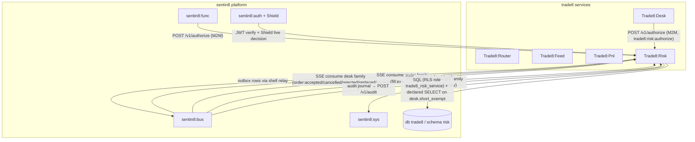
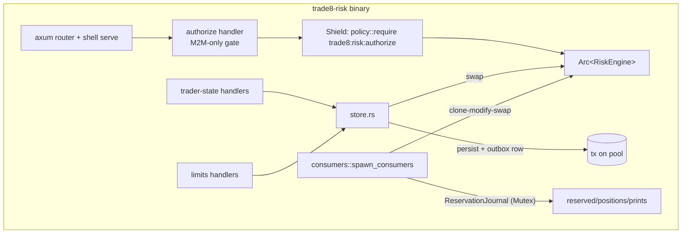
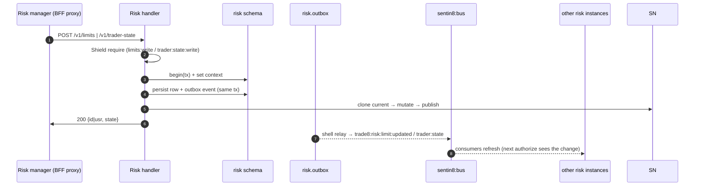
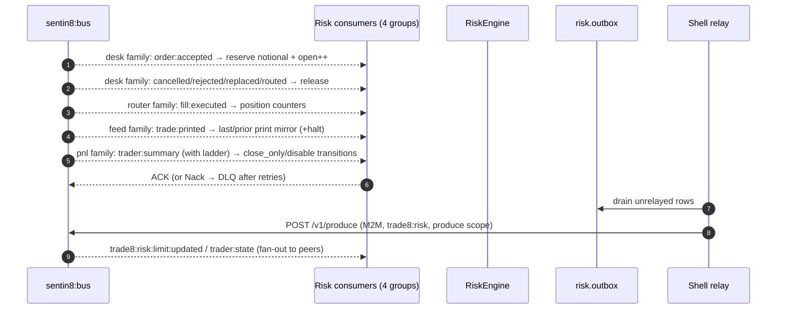
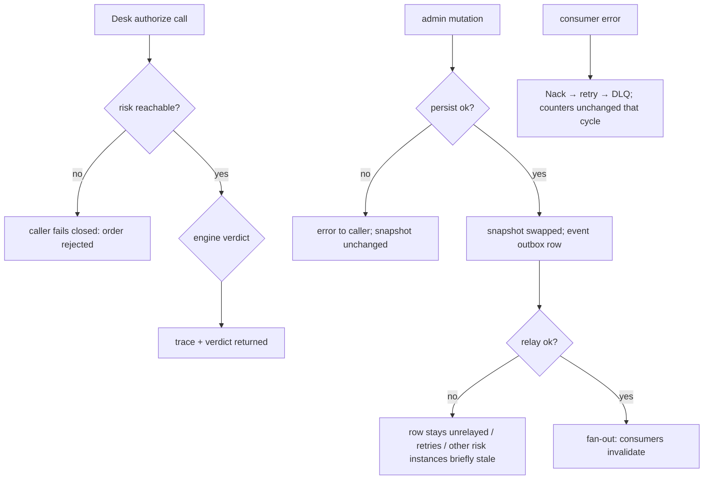
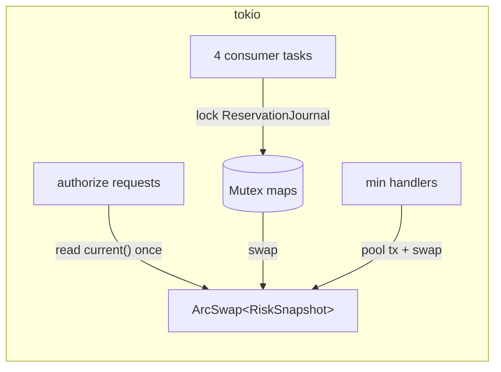
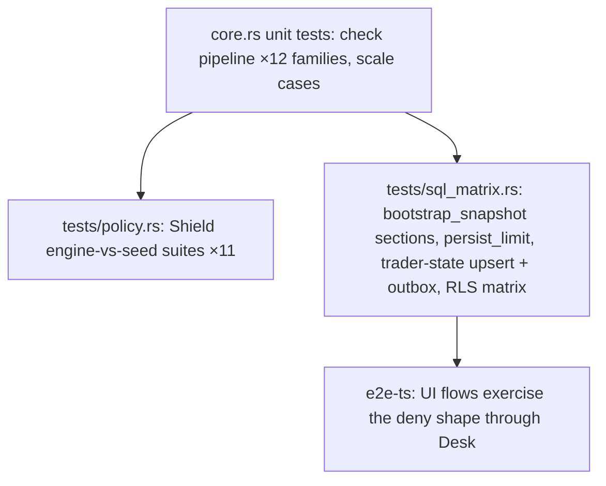

# DESIGN.md: Trade8:Risk — Detailed Design Document

> Audience: maintainers, reviewers, and architects modifying the service.
> Overview in `README.md`; business functionality in `BUSINESS.md`.

## 1. Scope & Context

**Owns**:

- The synchronous `authorize` verdict (pre-trade gate) and its itemized
  check trace; the trader-state runtime (`risk.trader_state`); the limit
  catalog (`risk.limit`); restrictions and allowlists
  (`risk.execution_restriction`, `risk.max_orders_restriction`,
  `risk.allowed_symbol`); the risk-level ladder config (`risk.level`,
  `risk.action`, `risk.level_action`); the `risk` event family
  (`events::FAMILY_RISK = "risk"`).

**Does NOT own** (delegates):

- Order state → **Trade8:Desk** (Risk only returns verdicts; Desk persists).
- Execution and fills → **Trade8:Router** (Risk consumes `fill:executed`
  for position counters).
- Day P&L and the ladder *evaluation trigger* → **Trade8:Pnl**
  (`trader:summary` drives ladder evaluation here, positions are Pnl's).
- Uptick inputs → **Trade8:Feed** (mirror comes from print events).
- Scheduling, identity, strategy execution, audit ingest → platform
  (Sentin8:Cron/Auth/Func/Sys).



## 2. Runtime Architecture



### Request lifecycle — the authorize family (the only hot family)

```mermaid
sequenceDiagram
    autonumber
    participant D as Trade8:Desk (M2M mTLS)
    participant A as Risk /v1/authorize
    participant S as Shield
    participant E as RiskEngine
    participant SN as RiskSnapshot (arc-swap)
    D->>A: POST /v1/authorize (AuthorizeRequest)
    A->>S: verify token + require trade8:risk:authorize
    S-->>A: allow (live roles) / 403
    A->>E: authorize(&req)
    E->>SN: current() — one generation
    E->>E: 1 trader state → 2 symbol allowlist/blocked → 3 destination → 3b market → 3c cancel-denial → 3d order-type/TIF → (opens: 4 buying power → 5 open orders → 6 order shares → 7 position shares) → 8 short locate + uptick
    E-->>A: verdict {allowed, trace, remaining_bp} or {deny, code, trace}
    A-->>D: 200 verdict
    Note over D,A: No DB touched; no cross-service calls on this path
```

### Mutation lifecycle — limits / trader states



## 3. Data Model

Schema `risk`, db `trade8`; role `trade8_risk_service` (no BYPASSRLS);
RLS ENABLE+FORCE + the standard 4-policy env block on every table;
outbox + audit journal shell-generated. Declared cross-schema grant:
`SELECT` on `desk.short_exempt`.

```mermaid
erDiagram
    limit {
        uuid id PK
        uuid env_id
        text usr_id "nullable — office/env scope rows null"
        text office_id "nullable"
        text asset_class "nullable"
        text currency "nullable"
        text kind "buying_power|max_order_shares|max_position_shares|max_position_value|max_open_orders|max_notional"
        bigint value
        bigint override_value "nullable — wins over value"
        boolean disabled
    }
    trader_state {
        uuid env_id PK
        text usr_id PK
        text state "active|closing_only|disabled_by_risk|disabled_by_compliance|disabled|inactive"
        text reason
        text set_by
    }
    execution_restriction {
        uuid env_id
        text restriction "blocked_symbol|blocked_destination|blocked_market|cancel_denial|allowed_order_types|allowed_tifs|uptick_rule"
        uuid symbol_id "nullable"
        uuid destination_id "nullable"
        uuid market_id "nullable"
        text level_id "scope key (usr|office|*)"
        text value "comma list or u/m/d"
        boolean disabled
    }
    max_orders_restriction {
        uuid env_id
        text level_id
        text type
        int max_orders
        int interval_s
    }
    allowed_symbol {
        uuid env_id
        text usr_id
        uuid symbol_id
    }
    level {
        uuid level_id PK
        uuid env_id
        bigint threshold
    }
    action {
        uuid action_id PK
        uuid env_id
        text action "notify|close_only|disable|flatten"
    }
    level_action {
        uuid level_id FK
        uuid action_id FK
    }
    level ||--o{ level_action : "wiring"
    action ||--o{ level_action : "wiring"
```



- `risk.limit` — six `kind`s; scope columns nullable by design (env row =
  default); `override_value` wins when non-null.
- `risk.trader_state` — upsert per (env, usr); the *runtime* trading state,
  not identity. Never written by Auth.
- `risk.level_action` — the threshold ladder wiring evaluated from Pnl
  summaries.
- No state machines: rows are current-state upserts; history lives in the
  audit journal.

## 4. API Surface

### Service-facing (M2M only — not proxied by BFF)

| Endpoint | Gate | Notes |
|---|---|---|
| `POST /v1/authorize` | Shield `trade8:risk:authorize` | The hot path; verdict + trace; fail-closed handled by the caller |

### Public (BFF-proxied, JWT bearer)

| Endpoint | Gate | Events |
|---|---|---|
| `GET /v1/limits` · `POST /v1/limits` | `trade8:risk:limits:read` / `:write` | `trade8:risk:limit:updated` (on POST) |
| `GET /v1/trader-state` · `GET /v1/trader-state/{usr_id}` | `trade8:risk:limits:read` | — |
| `POST /v1/trader-state` | `trade8:risk:trader:state:write` | `trade8:risk:trader:state` |

### Admin (RFW `GET /v1/admin/ui/{page}` + data endpoints)

| Page | Data endpoint |
|---|---|
| `limits` | `GET /v1/admin/limits` |
| `traders` | `GET /v1/admin/traders` |
| `restrictions` | `GET /v1/admin/restrictions` |
| `levels` | `GET /v1/admin/levels` |
| `exposure` | `GET /v1/admin/exposure` (reserved notional, open orders, positions vs limits) |

Plus the shared Shield policy-admin API block.

### Event flow (consumers and producer)



## 5. Cross-Cutting Concerns

- **AuthN/AuthZ** — full 8-step pipeline; Shield decides (`require` with
  `trade8:risk:*` targets); JWT `scope` only pre-filters.
- **Tenant resolution + RLS** — mutations: `set_tenant_context` then
  `begin()` on the same connection; bootstrap loads run on the boot-env
  context; explicit `WHERE env_id = $1` everywhere; `desk.short_exempt`
  read is a *declared* cross-schema grant only.
- **Idempotency** — reservation accounting keyed by order id; limit/
  trader-state writes are idempotent upserts; consumer redelivery converges.
- **Audit journaling** — local `risk.audit_journal` (same tx) → Sys
  ingest retry; deny-trace persistence is Desk's responsibility.
- **Fail-safety** — snapshot bootstrap is logged-not-fatal (empty snapshot
  authorizes nothing extra: no limits means no limit denies, but trader
  states/restrictions also default-open — see Open Questions).
- **TLS** — post-quantum via `sentin8-tls`; M2M cert-bound (`trade8:risk-{leaf}`-style workloads + `-tls` instance-read workload).

## 6. Failure Modes & Recovery



- **Risk down** → Desk fails closed (order rejected, nothing persisted).
- **Snapshot bootstrap failure** → logged, empty snapshot installed; the
  service still serves verdicts (empty limits bind nothing) — operator
  alerting owns the gap.
- **Outbox/relay outage** → mutation is durable and locally effective;
  remote instances refresh late (eventual consistency documented in §8).
- **Crash** → in-memory journal counters rebuild from desk/router events;
  `risk.trader_state`/`risk.limit` truth is in the DB.

## 7. Concurrency & Performance Model



- The authorize path is allocation-light and lock-free (one `ArcSwap` load);
  trace building is the only allocation-heavy step.
- The journal mutex guards O(1) map ops only.
- Pool use is mutation-only (persist paths); the pool cap comes from the
  shared `connect` helper.
- Consumer groups: `trade8:risk:{family}` ×4 (desk/router/feed/pnl).

## 8. Invariants, Insecure-Defaults Rejected, Unsafe Rationale

1. The authorize path performs no DB access, no cross-service HTTP, and no
   allocation-heavy work beyond the trace.
2. Unknown traders default to *active*: Risk authorizes by explicit
   restriction, never by absent permission — an env that wants
   allow-list-only traders must seed `risk.trader_state` (documented
   alternative: an env-level `closed` default flag — open question).
3. Limit rows bind only when enabled (disabled rows skipped), specificity
   user > office > env.
4. A deny is never "silent": every deny carries a machine-readable
   `RejectCode` and a full check trace.
5. Trader-state changes are Risk data only — zero writes to any identity
   store.
6. No `unsafe` blocks. `ArcSwap` guarantees the read-consistency invariant;
   the journal mutex is scoped to map operations only (no snapshot swaps
   under the lock).

## 9. Testing Strategy



- Unit: boundary cases for buying power (reserved + notional = limit),
  max-position projection (short sides), closing-only close vs open,
  cancel-denial windows, uptick modes, allowed-list semantics.
- `tests/sql_matrix.rs` (skip-offline): RLS matrix (no-context/cross-env →
  0 rows), `bootstrap_snapshot` all-sections load (limits/states/allowed/
  restrictions/uptick/exempt — disabled excluded), `persist_limit`,
  trader-state upsert + outbox events.
- `tests/policy.rs`: the shared Shield suites (no-set deny, shadow never
  blocks, M2M parity, live-role freshness, mirror parity).
- Deliberately not tested here: Desk submission choreography (Desk design),
  Pnl ladder math (Pnl design), bus delivery (platform).

## 10. Open Questions

- **Fail-open default for unrestricted traders** — an env without seeded
  states authorizes everything; a `default_trader_state` env setting
  (deny-by-default) is a real option and needs a product decision.
- **Multi-currency buying power** — the schema carries the columns; the
  single-pool arithmetic needs a conversion design (`desk.currency` rates).
- **Ladder persistence in snapshot** — move ladder thresholds from
  payload-carried to boot-loaded (and hot-swapped on `limit:updated`).
- **Restriction invalidation events** — publish
  `trade8:risk:restriction:updated` for multi-instance freshness.
- **`max_orders_restriction` enforcement point** — table + registration
  exist; the check pipeline currently uses `max_open_orders` only.

---

**Design attribution:** trade8:risk and its underlying concepts were designed by Hamid Jahanzad <Hamid@Jahanzad.com>.

