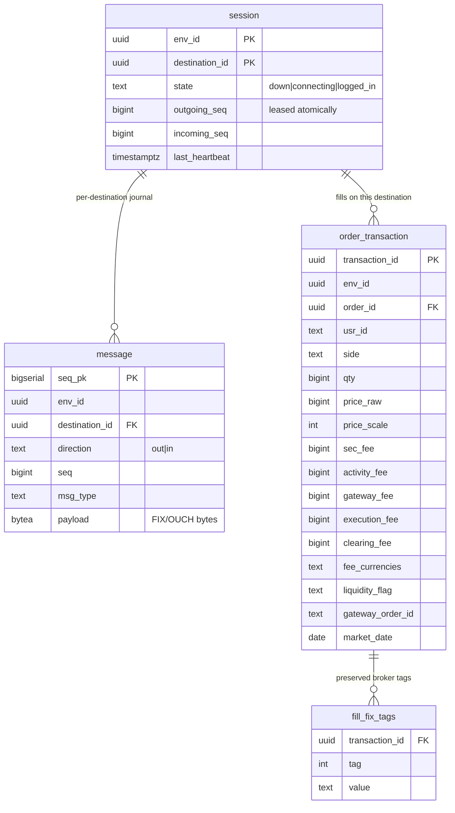
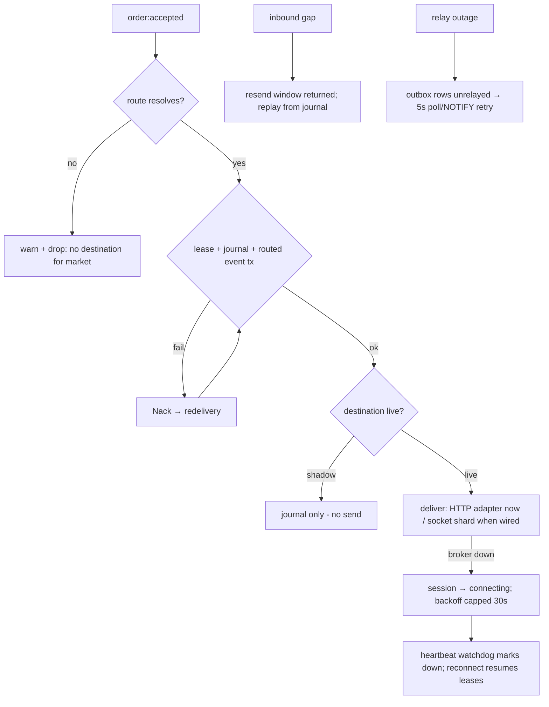
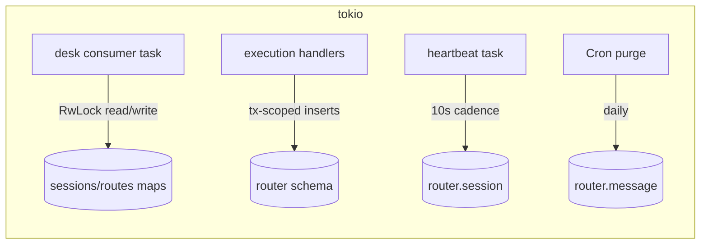
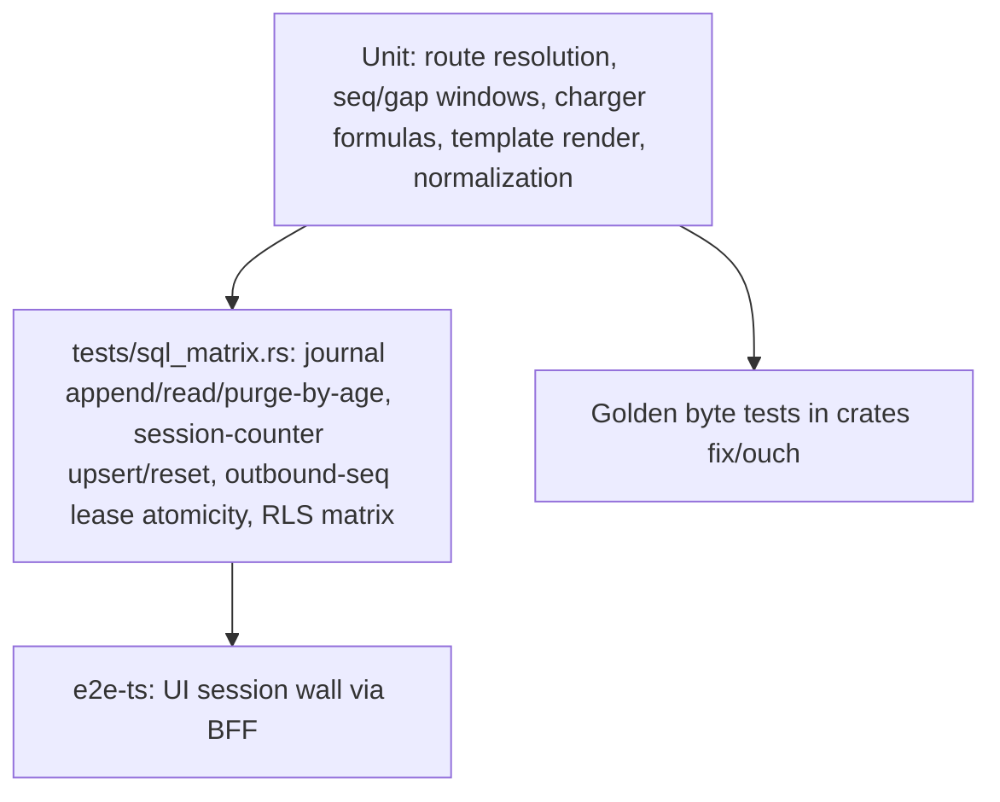

# DESIGN.md: Trade8:Router - Detailed Design Document

> Audience: maintainers, reviewers, and architects modifying the service.
> Overview in `README.md`; business functionality in `BUSINESS.md`.

## 1. Scope & Context

**Owns**:

- All outbound broker connectivity and its session bookkeeping (sequences,
  heartbeats, logons); the wire journal (`router.message`); per-destination
  session state (`router.session`); the fills (`router.order_transaction`,
  `router.fill_fix_tags`) - Router is the sole writer of execution records;
  the `router` event family (`trade8:router:*`).

**Does NOT own** (delegates):

- Routing catalogs → **Trade8:Desk** (`destination`, `gateway`,
  `market_gateway_destination`, `office_broker`, `msg_template` - read via
  declared cross-schema grants only).
- Order acceptance/authorization → **Trade8:Desk/Trade8:Risk**.
- Fee *catalog* (types/formulas/params source rows: `desk.fee_catalog`) →
  Desk; Router evaluates.
- P&L → Trade8:Pnl (consumes fills). Market data → Trade8:Feed.
- Scheduling (journal purge) → **Sentin8:Cron**.

```mermaid
graph TD
    subgraph desk[Trade8:Desk - catalog owner]
        DCAT[(desk.destination / gateway / market_gateway_destination / office_broker / msg_template)]
        DEVT[trade8:desk:order:accepted + :order:routed (router emits)]
    end
    subgraph router[Trade8:Router]
        CON[desk consumer: route → render → journal → routed event]
        EXEC[normalizer: inbound reports → fills + fees]
        SESS[session bookkeeping + heartbeat watchdog]
        CHG[fee charger]
    end
    subgraph platform[sentin8 platform]
        BUS[sentin8:bus]
        CRON[sentin8:cron]
        SYS[sentin8:sys]
        AUTH[sentin8:auth + Shield]
        DB[(db trade8 / schema router)]
    end
    subgraph external[External venues]
        BRK[Brokers - FIX 4.2/4.4, OUCH 3.1]
        X8[exchange8 Gateway adapter]
    end
    DCAT -- "declared SELECT grants" --> CON
    DEVT -- "SSE consume (group trade8:router)" --> CON
    CON -- "M2M order:routed event via outbox" --> BUS
    EXEC -- normalized fills + fees + fix tags (same tx) --> DB
    CON -- same tx: lease + journal --> DB
    CON -- sessions/heartbeats --> SESS
    EXEC --> CHG
    EXEC -- deliveries (HTTP octets, adapter pattern) --> X8
    BRK -- wire (socket-transport path) --> EXEC
    CRON -- "POST /v1/journal/purge (30d retention)" --> router
    BUS -- "fills fan-out: groups trade8:pnl:router / trade8:risk:router" --> PNL[Trade8:Pnl]
    AUTH -- "JWT (ops) + Shield" --> router
    router -- "audit journal → /v1/audit" --> SYS
```

## 2. Runtime Architecture

```mermaid
graph TD
    subgraph bind[trade8-router binary]
        RS[axum router + shell serve] --> OPS[ops handlers: sessions/messages/purge]
        OPS --> P[Shield gates: session:manage / session:read / journal:read]
        OPS --> ST[store.rs]
        CONC[desk consumer task] --> WIRE[wiring.rs: load routes/templates, render, lease, journal]
        EXECR[execution callback /v1/internal/executions/{dest}] --> NORM[core.rs normalize + charger]
        NORM --> FILLTX[(fills + fix tags + outbox, one tx)]
        WIRE --> SESS[(router.session + router.message)]
        HB[heartbeat watchdog task] --> SESS
    end
```

### Request lifecycle - routed order (desk consumer family)

```mermaid
sequenceDiagram
    autonumber
    participant B as sentin8:bus (desk family)
    participant C as Router consumer
    participant R as RouteTable + templates
    participant DB as router schema
    participant O as router.outbox
    B->>C: trade8:desk:order:accepted (SSE, M2M)
    C->>R: resolve(market, office) → destination (or drop + warn)
    C->>R: render template/codec default → wire bytes (price scaled to decimal)
    C->>DB: set context; begin(tx)
    C->>DB: UPDATE router.session SET outgoing_seq = outgoing_seq + 1 RETURNING (atomic lease)
    C->>DB: append journal row (direction out, seq, msg_type D, payload)
    C->>O: insert order:routed event row (same tx)
    alt journal or event fails
        C-->>B: Nack → redelivery (lease rolled back)
    else ok
        C-->>B: ACK
        Note over O,DB: live destinations deliver (socket path / HTTP adapter); shadow journals only
    end
```

### Fill lifecycle - inbound executions

```mermaid
sequenceDiagram
    autonumber
    participant GW as Broker / exchange8 adapter
    participant H as POST /v1/internal/executions/{dest}
    participant N as normalizer + charger
    participant DB as router schema
    participant O as router.outbox
    GW->>H: normalized broker report (M2M, trade8:router:executions:report)
    H->>N: parse (ExecutionReport / OUCH inbound)
    N->>N: map exec type → FillState; charge fees; preserve FIX tags
    H->>DB: begin(tx) + set context
    H->>DB: INSERT order_transaction + fill_fix_tags + outbox(fill:executed|cancelled|rejected)
    alt any insert fails
        H-->>GW: 5xx (adapter re-posts)
    else ok
        H-->>GW: 200 {transaction_id}
        O-->>BUS: shell relay → groups trade8:pnl:router, trade8:risk:router (ACK/Nack→DLQ)
    end
```

## 3. Data Model

Schema `router`, db `trade8`; role `trade8_router_service`; RLS env block;
shell-generated outbox/journal.



- `router.message` - retention-purged via Cron (30-day default); BYTEA wire
  payloads; per-destination seq ordering.
- `router.order_transaction` - the fills (relocated from Desk; Router sole
  writer); fee columns are ×10⁴ raw ints with currency refs preserved for
  conversion at Pnl.
- `router.fill_fix_tags` - broker-dialect tags preserved verbatim.
- `desk.*` reads: `destination`, `gateway`, `market_gateway_destination`,
  `office_broker`, `msg_template` (declared cross-schema grants in
  registration + init.sql grants block).

## 4. API Surface

### Public (BFF-proxied ops)

| Endpoint | Gate | Notes |
|---|---|---|
| `GET /v1/sessions` | `trade8:router:session:manage` | destination session wall |
| `POST /v1/sessions/{id}/reset` | `trade8:router:session:manage` | sequence reset (audited) |
| `GET /v1/messages` | `trade8:router:session:read` | journal window |
| `POST /v1/journal/purge` | `trade8:router:journal:read` | Cron proxy-back (30d retention) |

### Internal (M2M)

| Endpoint | Gate |
|---|---|
| `POST /v1/internal/executions/{destination}` | `trade8:router:executions:report` |

### Admin (RFW `GET /v1/admin/ui/{page}`)

| Page | Data endpoint |
|---|---|
| `sessions` | `GET /v1/admin/sessions` (+ POST reset alias) |
| `journal` | `GET /v1/admin/journal` |
| `fees` | `GET /v1/admin/fees` (fee catalog from `desk.fee_catalog`) |

Plus the shared Shield policy-admin API block. (Design §registration
declares the additional destinations/templates/messages admin endpoints;
they are implemented at the desk/router pages above - the disposition is
tracked in Open Questions.)

### Events

| Direction | Event | Trigger |
|---|---|---|
| Emitted | `trade8:router:fill:executed` | inbound fill/correction normalized |
| Emitted | `trade8:router:fill:cancelled` | broker cancel of resting order |
| Emitted | `trade8:router:fill:rejected` | broker reject |
| Emitted | `trade8:router:session:status` | session state transitions |
| Emitted | `trade8:desk:order:routed` | accepted order leased + journaled |
| Consumed | `trade8:desk:order:accepted` | route/render/journal lease |

(Outbox → relay → consumer flow: see the sequence diagrams in §2.)

## 5. Cross-Cutting Concerns

- **AuthN/AuthZ** - 8-step pipeline; Shield targets
  `trade8:router:{session,executions,journal}:*`; internal execution
  callbacks are M2M-gated with the declared `executions:report` action.
- **Tenant + RLS** - consumer/execution paths set context on the pool
  connection then `begin()`; explicit env filters; declared desk-catalog
  grants only (no blanket schema access); service role has no BYPASSRLS.
- **Idempotency** - sequence lease is atomic per destination; fills dedupe
  on broker `exec_id`/transaction id; outbox rows keyed by row id.
- **Audit** - wire journal + preserved FIX tags are the compliance record;
  audit journal rows pushed to Sys with retry.
- **Secrets** - `credentials_ref` is a secret reference; Router never
  persists plaintext broker credentials.
- **TLS** - post-quantum via `sentin8-tls`; broker dial-out inherits the
  platform TLS posture when endpoints support it.
- **Graceful drain** - shell upgrade-instance drains; sessions reconnect on
  the new instance (state is DB-backed).

## 6. Failure Modes & Recovery



- **Broker session loss** - watchdog marks down after stale heartbeat;
  reconnect re-logs on (seq-continuation or reset per policy).
- **Inbound gap** - resend window computed from the journal; gaps replay
  from stored messages.
- **Transaction failure** - consumer Nacks; leases roll back; redelivery
  re-leases (deduped by idempotency semantics downstream).
- **Purge safety** - the purge deletes only rows older than retention and
  runs inside a scheduled window.

## 7. Concurrency & Performance Model



- Single consumer for the desk family (order routing is low-rate vs fills);
  per-destination FIFO within consumer handling.
- The normalizer hot path is allocation-light (byte buffers + one tx).
- Heartbeat watchdog runs on a 10s cadence (SQL-only update).
- Pool capped via the shared helper; txs are short (lease/insert).

## 8. Invariants, Insecure-Defaults Rejected, Unsafe Rationale

1. Fills are written exactly once per broker execution and only by Router;
   no other service holds insert grants on `router.order_transaction`.
2. Outbound wire messages exist in the journal iff the lease happened -
   one tx, no partial delivery states.
3. Shadow sessions never transmit; the journal keeps their mirror.
4. Plaintext broker credentials are never stored (secret refs only) and
   never echoed through admin surfaces.
5. Fee formulas are data, evaluated by the tested DSL - no free-text
   formula execution.
6. No `unsafe` blocks; codecs verify checksums (FIX) and frame lengths
   (OUCH) and reject malformed input.

## 9. Testing Strategy



- Golden wire tests live with the codecs (crates `fix`/`ouch`).
- Charger differential tests pin each formula type against hand-computed
  values (×10⁴ scale).
- `tests/sql_matrix.rs` (skip-offline): RLS matrix; journal
  append/read-filter/purge-by-age; session-counter upsert/reset;
  outbound-seq lease atomicity.
- Deliberately not tested here: broker side of the wire (integration
  venue), Desk submit choreography, Pnl fold math.

## 10. Open Questions

- **Socket transport for FIX/OUCH dial-out** - final wiring of the session
  state machines to live TCP/TLS endpoints (designed; the HTTP adapter
  pattern is implemented for exchange8-style gateways).
- **Registration/admin endpoint parity** - `registration.rs` declares
  `/v1/admin/templates`, `/v1/admin/messages`, `/v1/admin/destinations`
  data endpoints that `main.rs` does not route yet (the destinations editor
  lives in Desk's admin pages): implement or prune the declarations.
- **Fee condition predicates** - the design's condition DSL (typed
  predicates) vs free `fee_catalog` params: which surface admins edit.
- **Resend-from-journal driver** - the end-to-end resend loop needs a live
  session to be exercised; add a session-sim fixture to the integration
  layer.

---

**Design attribution:** trade8:router and its underlying concepts were designed by Hamid Jahanzad <Hamid@Jahanzad.com>.

